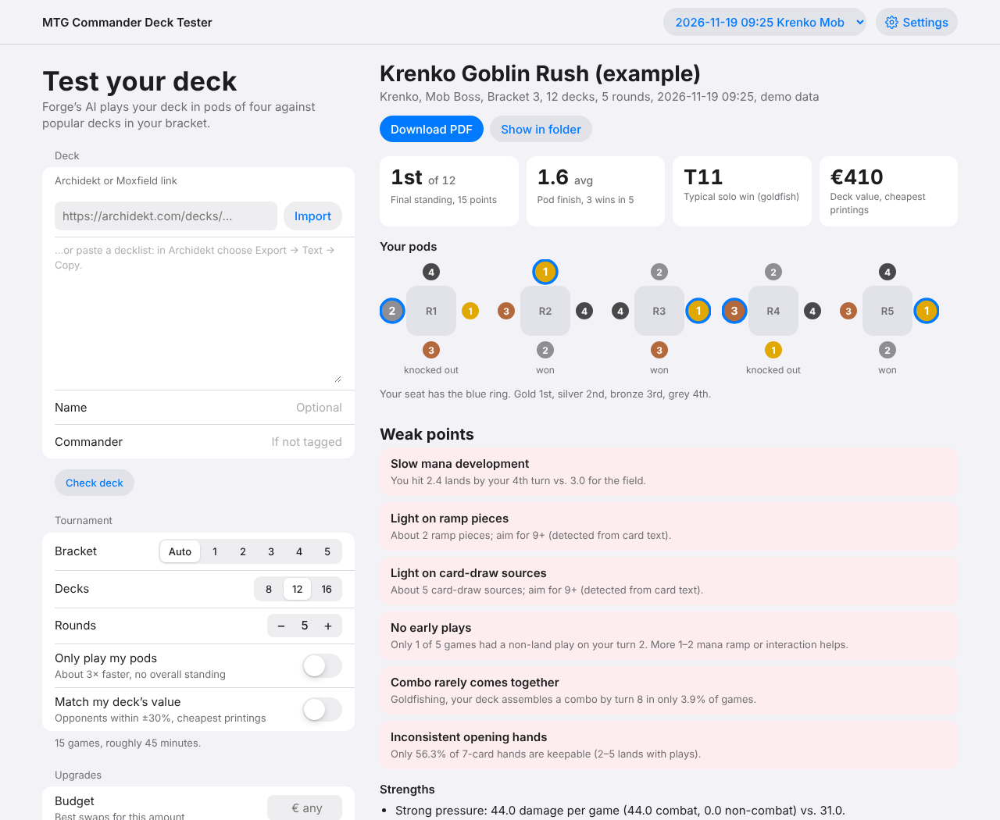

# MTG Commander Deck Tester

[](LICENSE)


Paste your Commander decklist and let the computer play a whole test tournament for you.
[Forge](https://github.com/Card-Forge/forge)'s AI pilots every deck in pods of four against popular
decks from Archidekt (and optionally Moxfield) in your bracket. You get a PDF report with your
final standing, your place in every pod, your deck's weak points and concrete suggestions.



**Example report:** [docs/example-report.pdf](docs/example-report.pdf) (made with demo data)

## Contents

- [What you get](#what-you-get)
- [What you need](#what-you-need)
- [Installation on macOS](#installation-on-macos)
- [Installation on Windows](#installation-on-windows)
- [Using the app](#using-the-app)
- [How opponents are chosen](#how-opponents-are-chosen)
- [Upgrades, prices and EDHREC](#upgrades-prices-and-edhrec)
- [Combos and consistency](#combos-and-consistency)
- [Opening hands and early plays](#opening-hands-and-early-plays)
- [How the tournament works](#how-the-tournament-works)
- [Play style: AI personality and mulligans](#play-style-ai-personality-and-mulligans)
- [Speed and sleep](#speed-and-sleep)
- [Optional extras](#optional-extras)
- [Where your files are](#where-your-files-are)
- [Updating and uninstalling](#updating-and-uninstalling)
- [Limitations](#limitations)
- [For developers](#for-developers)
- [License and credits](#license-and-credits)

## What you get

- **Final standing** in a Swiss-style tournament (8, 12 or 16 decks) and your **place in every pod**
- **Weak points**, found by comparing your deck with the rest of the field across all games:
  land drops by turn 4, when your commander comes down, damage dealt and taken, mulligans,
  spells per turn and how you lost (combat, commander damage, combos...)
- **Recommended upgrades with prices**: add/cut swaps with the most impact for a budget you choose,
  based on EDHREC, your weak points and combos (prices from Cardmarket, in EUR)
- **EDHREC comparison**: popular cards with your commander that you don't play, and your unusual picks
- **Combos and consistency**: every combo in your deck (from Commander Spellbook), how fast your
  deck assembles them, combos you're one card away from and combos above your bracket
- **Win check**: the turn your deck typically wins on its own, through combat, commander damage,
  drain, poison, mill or combos
- **Key moments** of every game: your spells round by round, life totals, who knocked out whom
- **Opening hands and early plays**: the hand your deck kept in every game, and whether it
  cast something other than a land on its turn 1 and turn 2
- **Coaching notes from Claude** (optional): concrete cut → add swaps that respect your bracket and budget
- A **PDF report** that reads well on phones, tablets and computers

## What you need

| | Needed for | Cost |
|---|---|---|
| Python 3.9 or newer | Running this app | Free |
| Java 17 or newer, as a **JDK** | Running Forge; the JDK's compiler records opening hands | Free |
| Forge | Playing the games | Free |
| Internet connection | Card data and opponent decks | – |
| 8 GB RAM (16 GB recommended) | Each running Forge game uses up to 3 GB | – |
| Claude API key | Coaching notes (optional) | Pay per use |

---

## Installation on macOS

Works on macOS 12 or newer, on Apple silicon (M1 and later) and Intel Macs.

### Step 1: Install Python

1. Go to https://www.python.org/downloads/macos/ and download the latest **macOS 64-bit universal2 installer**.
2. Open the downloaded `.pkg` and click through the installer.

To check: open **Terminal** (Spotlight → "Terminal") and type `python3 --version`. It should
show 3.9 or higher.

### Step 2: Install Java

1. Go to https://adoptium.net/temurin/releases/.
2. Choose **Operating System: macOS**, **Architecture: aarch64** for Apple silicon or **x64** for
   Intel (Apple menu → About This Mac tells you which), **Package type: JDK**, version **21** (LTS).
3. Download the **.pkg** and install it.

To check: in Terminal type `java -version`. It should show version 17 or higher.

### Step 3: Install Forge

1. Go to https://github.com/Card-Forge/forge/releases and open the latest release.
2. Under **Assets**, download the file ending in **.tar.bz2** (currently named like
   `forge-installer-<version>.tar.bz2`; despite the name it's the ready-to-use program, no installer runs).
3. Double-click it in Downloads to unpack it.
4. Rename the unpacked folder to `Forge` and move it into your home folder (Finder → Go → Home).

Optional check: open the folder and double-click `forge.command` to make sure Forge starts.
You don't need to download card images.

### Step 4: Download this app

On this GitHub page click **Code → Download ZIP**, then double-click the ZIP to unpack it.
Move the folder somewhere permanent, e.g. your Documents folder.

### Step 5: Start the app

Double-click **`start-mac.command`**.

The first time, macOS blocks files downloaded from the internet. Do one of these:

- **Easiest:** open Terminal, type `bash ` (with a space), drag `start-mac.command` into the
  Terminal window and press Enter.
- **Or:** double-click it, click **Done** on the warning, then open **System Settings → Privacy &
  Security**, scroll down and click **Open Anyway** next to `start-mac.command`.

The first start takes a minute (it sets up a private Python environment and installs two small
packages). Then your browser opens **http://127.0.0.1:8765**. Keep the Terminal window open while
you use the app; close it to quit.

### Step 6: Point the app to Forge

The first time, the Settings window opens. If the Forge folder isn't filled in, drag your `Forge`
folder from Finder into the **Forge folder** box, click **Check Forge and Java**, then **Save settings**.

### macOS troubleshooting

| Problem | Fix |
|---|---|
| "start-mac.command can't be opened" / "not verified" | Use the Terminal method in step 5. |
| "Permission denied" | In Terminal: `chmod +x ` then drag the file in, press Enter. Or use `bash start-mac.command`. |
| "Java was not found" | Install Temurin (step 2), then close and restart the app. |
| "certificate verify failed" | Delete the `.venv` folder inside the app folder and start again. |
| Mac gets very slow during a test | Settings → **Games at once** → 1 or 2. |
| Opening hands say "not recorded" | You have a Java runtime without the compiler. Install the Temurin **JDK** (step 2) and restart the app. |

---

## Installation on Windows

Works on Windows 10 and 11 (64-bit).

### Step 1: Install Python

1. Go to https://www.python.org/downloads/windows/ and download the latest **Windows installer (64-bit)**.
2. Run it. On the first screen tick **"Add python.exe to PATH"**, then click **Install Now**.

To check: open **Command Prompt** (Start → type `cmd`) and type `py --version`. It should show
3.9 or higher.

### Step 2: Install Java

1. Go to https://adoptium.net/temurin/releases/.
2. Choose **Operating System: Windows**, **Architecture: x64**, **Package type: JDK**, version **21** (LTS).
3. Download the **.msi** and run it. On the "Custom Setup" screen, set **"Set JAVA_HOME variable"**
   to "Will be installed on local hard drive" (recommended, not required).

To check: in a new Command Prompt type `java -version`. It should show version 17 or higher.

### Step 3: Install Forge

1. Go to https://github.com/Card-Forge/forge/releases and open the latest release.
2. Under **Assets**, download the file ending in **.tar.bz2** (currently named like
   `forge-installer-<version>.tar.bz2`; despite the name it's the ready-to-use program, no installer runs).
3. Unpack it:
   - **Windows 11:** right-click the file → **Extract All**.
   - **Windows 10:** install the free [7-Zip](https://www.7-zip.org), right-click → 7-Zip →
     **Extract Here**, then do the same with the `.tar` file that appears.
4. Rename the unpacked folder to `Forge` and move it to `C:\Forge` (or your user folder).

Optional check: double-click `forge.exe` in that folder to make sure Forge starts.

### Step 4: Download this app

On this GitHub page click **Code → Download ZIP**.
Before unpacking, right-click the ZIP → **Properties** → tick **Unblock** (if shown) → **OK**.
Then right-click → **Extract All** and move the folder somewhere permanent, e.g. Documents.

### Step 5: Start the app

Double-click **`start-windows.bat`**.

If Windows shows a security warning, click **Run** (or **More info → Run anyway** on the blue
"Windows protected your PC" screen). Unblocking the ZIP in step 4 usually prevents this.

The first start takes a minute (it sets up a private Python environment and installs two small
packages). Then your browser opens **http://127.0.0.1:8765**. Keep the black window open while you
use the app; close it to quit.

### Step 6: Point the app to Forge

The first time, the Settings window opens. If the Forge folder isn't filled in, type its path
(e.g. `C:\Forge`), click **Check Forge and Java**, then **Save settings**.
Tip: in File Explorer, Shift + right-click the folder → **Copy as path**, then paste.

### Windows troubleshooting

| Problem | Fix |
|---|---|
| "Python 3 is not installed" | Reinstall Python and tick "Add python.exe to PATH". Restart the computer. |
| The Microsoft Store opens when Python starts | Settings → Apps → Advanced app settings → App execution aliases → turn off the two "python" entries. |
| "Java was not found" | Install Temurin (step 2), then close and restart the app. |
| The window closes immediately | Open Command Prompt, `cd` into the app folder and run `start-windows.bat` to see the error. |
| PC gets very slow during a test | Settings → **Games at once** → 1 or 2. |
| Opening hands say "not recorded" | You have a Java runtime without the compiler. Install the Temurin **JDK** (step 2) and restart the app. |

---

## Using the app

1. **Add your deck**, either way:
   - Paste a deck link from **Archidekt** into the link field and click **Import**. The deck must be
     public. (Moxfield links need a Moxfield User-Agent, see [Optional extras](#optional-extras).)
   - Or copy the list: in Archidekt **Export → Text → Copy**, in Moxfield **Export** → copy the list,
     and paste it into the big text field. If the commander isn't found, type it into **Commander**.
2. Click **Check deck** to see lands, ramp, draw, removal, an estimated bracket and the deck's value.
3. Choose the **bracket** (or Auto), the number of **decks** and **rounds**. Optionally switch on
   **Match my deck's value** and enter a **budget** for upgrades.
4. Optional: set the **play style** (AI personality, mulligan rules) and paste links of decks you
   definitely want to face into **Specific opponents**.
5. Click **Start test**. Progress is shown at the top right; "Show log" shows every step.
6. When it finishes, click **Download PDF**. Past reports are in the menu at the top.

**How long does it take?** One Forge game usually takes 1–6 minutes. The default (12 decks,
5 rounds = 15 games) takes roughly 20–45 minutes, depending on your computer and how long your
decks' games last. "Only play my pods" is about three times faster but gives no overall standing.

## How opponents are chosen

1. **Popular, but varied:** the app looks at a few hundred of the most-viewed public Commander decks
   on Archidekt (and Moxfield, if enabled) and picks at random among them, with more popular decks
   more likely. Decks you faced in your last 3 runs are rarely picked again, so repeated runs see
   different opponents. Recently edited but unknown decks are not used.
2. **Same bracket:** only decks with your bracket. Decks without a bracket set are used only if
   there aren't enough.
3. **Varied colours:** every colour identity gets one deck before any identity gets a second, and
   your own colour identity is counted too. The log lists the identities in the field.
4. **Variety:** at most one deck with your own commander (two in a 16-deck field), no duplicate
   commanders, no copies of your own deck, and only legal 100-card decks.
5. **Value (optional):** with **Match my deck's value** on, only decks worth within ±30% of yours
   are used, comparing every deck at its cheapest printings. If there aren't enough, the app widens to ±50%, then any value, and says so in the log.

## Upgrades, prices and EDHREC

- **Prices** are for the **cheapest paper printing** of each card (Cardmarket trend price in EUR via
  Scryfall), so expensive special printings in a decklist don't inflate its value. Cards whose
  standard printing costs under €0.30 aren't looked up individually. Prices are refreshed weekly.
- **Recommended upgrades:** every possible addition gets an impact score from how often players
  run it with your commander on EDHREC, its synergy with your commander, the opponent decks,
  whether it fixes one of your weak points (ramp, draw, removal, board wipes, interaction) and
  whether it completes a combo allowed in your bracket. Each addition is paired with a cut: cards
  you never cast in testing or that are rarely played with your commander. Cards that fill a role
  your deck is already short on are never suggested as cuts.
- **Budget:** enter an amount and the app picks the highest-impact swaps that fit it. Without a
  budget it shows the highest-impact swaps regardless of price.
- **EDHREC comparison:** popular cards with your commander that you don't play, and your unusual
  picks (your spice, or candidates to cut). EDHREC has no official API; the app reads the data its
  website uses, slowly and cached for a week. If EDHREC changes its format, this section is
  skipped and the log says so.

## Combos and consistency

Forge's AI decides card by card and doesn't plan combos, so combo decks test worse in Forge than
they play. The report therefore adds a section that doesn't rely on Forge's AI:

- **Your combos:** your decklist is checked against [Commander Spellbook](https://commanderspellbook.com),
  the community combo database. Each combo links to its Commander Spellbook page.
- **Goldfish speed:** the app plays your deck alone 6,000 times, deliberately: ramp first, tutors
  fetch missing combo pieces, combo cards are held until they can be used. It reports how often
  each combo is assembled by turn 4, 6 and 8, and the typical turn.
- **Consistency:** keepable 7-card hands, non-land plays on turns 1 and 2, commander on curve,
  mana screw and flood, mana on turns 4 and 6.
- **Forge check:** how often Forge's AI cast every piece of a winning combo and still didn't win.
- **One card away:** combos you'd complete by adding one card, only in your colours and bracket.
- **Above your bracket:** combos Commander Spellbook rates higher than the bracket you chose.
- **The field:** how many counterspells and instant-speed removal spells the opponents run, and the
  chance one of three opponents holds a counterspell by turn 6. (Only your own deck is checked for
  combos, which keeps runs quick.)

- **Win check:** the same goldfish games continue to turn 15 against three opponents at 40 life who
  never block. It reports how often the deck wins alone by turn 8, 10 and 12, the typical winning
  turn and where the damage comes from (combat, commander damage, non-combat triggers and drain,
  poison, mill). Draw punishers like Nekusar or Underworld Dreams count every card the opponents
  draw, including extra draws and wheels. Cards that
  say "you win the game" are listed with how often they could be cast by turn 8.

The goldfish is an estimate: there are no opponents, and card effects are simplified to ramp, card
draw, tutors, damage and the combo pieces. Token makers and pump effects aren't counted, so wide
token decks are faster than shown. Use it to compare versions of your deck rather than as a promise.

## Key moments

For every game of your deck the report shows a short round-by-round summary (one round = every
player took a turn): the spells you cast, everyone's life total at the end of the round, who was
knocked out and by which card, and big damage swings, split into combat and non-combat damage.
In the app, click a game to open it.

When a spell is cast more than once in a game, the summary says how it came back, for example
"cast 3× – returned to hand as it resolved (e.g. buyback)", "returned from the graveyard to hand"
or "cast from the graveyard (e.g. flashback)". Forge's own log doesn't record this, so the app's
Forge helper adds it; without the helper it says "how it came back isn't in Forge's log".

**You vs. the field** also splits damage into combat damage and non-combat damage (triggers like
Nekusar's, burn spells). Life loss that isn't damage, such as drain effects, isn't counted there.

## Opening hands and early plays

The report ends with a summary for your deck: the opening hand it kept in every game (after
mulligans) and whether it cast something other than a land on its own turn 1 and turn 2, plus
totals such as "non-land play on turn 2 in 4 of 5 games".

Forge doesn't write opening hands into its game log, so the first time you run a test the app
builds a small helper (`mtg_deck_tester/java/HandSim.java`) with the JDK's Java compiler, against
your own copy of Forge. The same helper also makes runs faster and enables the play-style options
below. If no JDK is found, everything else still works: games run in Forge's normal mode, and hands
show as "not recorded". Forge gives a free first mulligan in Commander; it is included in the
mulligan count.

## How the tournament works

- Every round all decks play in pods of four. After round 1, decks with similar scores meet (Swiss).
- Seats are random. Places come from the order players are knocked out.
- Points per game: 1st 4, 2nd 2, 3rd 1, 4th 0. Games that are stopped (time limit, turn limit, or no
  life total changed for 16 turns) are draws: players still alive get 1 point.

## Play style: AI personality and mulligans

- **AI personality:** pick one of Forge's six built-in AI profiles (Default, Cautious, Reckless,
  Experimental, Hard, Hardest) for your deck and one for the opponents. They change how
  aggressively the AI attacks, trades creatures and uses counterspells.
- **Mulligan rules for your deck:** keep only hands with a set number of lands (e.g. 3–5), optionally
  require a play costing 2 mana or less, and set the most mulligans to take. Without rules, Forge
  decides as usual. The report shows which settings were used.

These options need the helper described in [Opening hands](#opening-hands-and-early-plays).

## Speed and sleep

- **Forge starts once per worker** and plays all its games in that session, instead of spending
  10–20 seconds starting up before every game. It restarts itself every 12 games to stay fresh.
- **Games at once** is set automatically from your computer's cores and memory (about 3 GB per
  game). You can choose a fixed number in Settings.
- **Stalled games end early:** after 60 turns (15 rounds), or when no life total changed for
  16 turns, a game ends as a draw.
- **Sleep-proof:** while a test runs, the app keeps the computer awake (on a Mac also when the
  display turns off, as long as it's on power). If it sleeps anyway, for example when you close a
  MacBook's lid, the tournament pauses and continues after waking; sleep time doesn't count towards
  the time limit.

## Optional extras

### Coaching notes from Claude

1. Create an API key at https://console.anthropic.com (requires an Anthropic account with credit).
2. Paste it into **Settings → Claude API key** and save.
3. Tick **Coaching notes from Claude** before starting a test.

One report costs a few cents. The key is stored only on your computer.

### Moxfield as an opponent source

Moxfield's terms don't allow automated access without permission. To use it:

1. Email support@moxfield.com, explain this personal, non-commercial use and ask for a User-Agent.
2. Paste the string you receive into **Settings → Moxfield User-Agent** and save.

Without it, opponents come from Archidekt only. Moxfield links in "Specific opponents" also need it.

## Where your files are

| | macOS | Windows |
|---|---|---|
| Reports (PDF, Markdown, game logs) | `~/MTG Commander Deck Tester/results/` | `C:\Users\<you>\MTG Commander Deck Tester\results\` |
| Settings (incl. API keys) | `~/MTG Commander Deck Tester/settings.json` | `C:\Users\<you>\MTG Commander Deck Tester\settings.json` |
| Card and deck cache | `~/MTG Commander Deck Tester/cache/` | `C:\Users\<you>\MTG Commander Deck Tester\cache\` |

Never share `settings.json`: it contains your API keys.

## Updating and uninstalling

- **Update:** download the new ZIP, replace the app folder, start it as usual. Your reports and
  settings are kept (they live in your home folder).
- **Uninstall:** delete the app folder and the `MTG Commander Deck Tester` folder in your home folder.
  Forge, Java and Python can be removed separately.

## Limitations

- Forge's AI plays reasonably but not like a strong human: it's weaker with complex combos,
  politics and some stack tricks. Look for patterns across rounds, not single games.
- Very new cards may not be in Forge yet; unknown cards are listed in the log.
- Archidekt's search API is unofficial and may change. If too few decks are found, paste deck
  links into "Specific opponents".
- The app was built and tested against Forge 2.0.16. Newer Forge versions usually work; if the
  opening-hand helper stops compiling, the app falls back to Forge's normal mode automatically.
- The combo section depends on Commander Spellbook, and the comparison on EDHREC, being reachable;
  without them the rest of the report is still created.
- Prices are for one printing per card and can differ from what you'd actually pay.
- Weak points like "light on ramp" come from simple card-text rules and can miss unusual cards.

## For developers

```
mtg_deck_tester/
├── app.py          local web server and job runner
├── decklist.py     decklist parser (Archidekt / Moxfield / plain text)
├── scryfall.py     card data lookup and cache
├── archidekt.py    Archidekt search and deck download
├── moxfield.py     Moxfield search and deck download (opt-in)
├── opponents.py    picks a popular, varied field of opponents
├── forge.py        runs Forge's simulation mode and parses its game logs
├── java/HandSim.java  Forge helper: one session for many games, opening hands, mulligan rules,
│                      AI profiles, stall detection (compiled locally against your Forge)
├── edhrec.py       EDHREC commander data
├── budget.py       priced upgrade suggestions and EDHREC comparison
├── power.py        keeps the computer awake during a test
├── fonts/          Inter font for the PDF (SIL Open Font License)
├── tournament.py   Swiss pods of four, run on parallel Forge sessions
├── spellbook.py    Commander Spellbook combo lookup
├── goldfish.py     solo Monte Carlo simulation (speed, consistency, combo and win turns)
├── combos.py       combo section: your combos, field interaction, Forge cross-check
├── analysis.py     weak points, suggestions, optional Claude notes
├── report_pdf.py   PDF report (ReportLab)
├── report_md.py    Markdown report
├── demo.py         fake games for trying the app without Forge
└── static/index.html  the interface
```

Run it without the launchers:

```bash
python3 -m venv .venv
source .venv/bin/activate        # Windows: .venv\Scripts\activate
pip install -r requirements.txt
python -m mtg_deck_tester         # options: --demo  --port 8766  --no-browser
```

`demo-mac.command` / `demo-windows.bat` start the app with fake games, so you can try the
interface without Java or Forge. Linux works too with the commands above (not officially tested).

**Publishing a fork:** upload with `git` or GitHub Desktop rather than the web uploader, so
`start-mac.command` keeps its executable flag. If it gets lost:
`git update-index --chmod=+x start-mac.command demo-mac.command`.

Bug reports and pull requests are welcome; see the [changelog](CHANGELOG.md) for recent changes.

## License and credits

The code of this project is released under the [MIT License](LICENSE). Third-party software,
services and their licenses are listed in [THIRD_PARTY_NOTICES.md](THIRD_PARTY_NOTICES.md):
Forge (GPL-3.0) and Java are installed separately and not included; ReportLab (BSD) and certifi
(MPL-2.0) are installed from PyPI; the Inter font (OFL-1.1) is included with its license.

Thanks to the [Forge](https://github.com/Card-Forge/forge) developers, [Commander Spellbook](https://commanderspellbook.com), [EDHREC](https://edhrec.com), [Scryfall](https://scryfall.com),
[Archidekt](https://archidekt.com) and [Moxfield](https://moxfield.com).

The PDF reports use the [Inter](https://rsms.me/inter/) typeface (SIL Open Font License 1.1),
included in `mtg_deck_tester/fonts/` with its license.

MTG Commander Deck Tester is unofficial Fan Content permitted under the
[Fan Content Policy](https://company.wizards.com/en/legal/fancontentpolicy). Not approved/endorsed by
Wizards. Portions of the materials used are property of Wizards of the Coast. ©Wizards of the Coast LLC.
